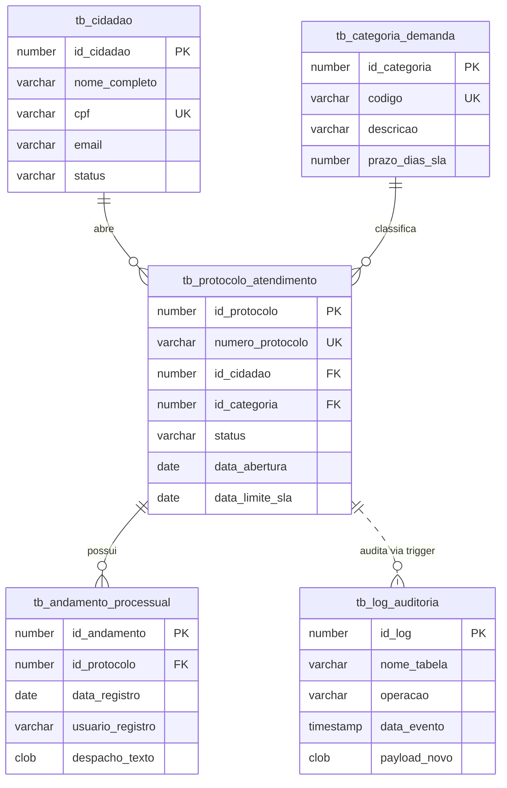

# 🏛️ Oracle PL/SQL & APEX Enterprise Toolkit

> Padrões arquiteturais corporativos em **Oracle Database** e **Oracle APEX**: Packages modulares, integração REST com `APEX_WEB_SERVICE`, triggers de auditoria autônoma, tratamento de exceções (erros ORA/PLS) e queries analíticas avançadas.

<p align="center">
  
  
  
  
</p>

---

## 📌 Visão Geral

Este repositório foi estruturado para demonstrar na prática técnicas e boas práticas do ecossistema Oracle voltadas para cenários corporativos reais (gestão de processos, protocolos, ouvidoria e fiscalização municipal).

O projeto aborda desde a modelagem de dados relacional com integridade referencial estrita até o consumo de APIs externas via web services e auditoria transacional.

---

## 🏗️ Arquitetura do Banco de Dados



---

## 📂 Organização dos Módulos

### 1. `01_schema_ddl/` — Modelagem e Estrutura Relacional
- **`01_create_tables.sql`**: Tabelas com Primary Keys, Foreign Keys com `ON DELETE CASCADE`, constraints de unicidade (`UNIQUE`), checagem (`CHECK`) e campos `IDENTITY`.
- **`02_create_indexes.sql`**: Índices B-Tree para Foreign Keys, índices compostos para status/datas e índices baseados em função (`Function-Based Index`) como `UPPER(email)`.
- **`03_seed_data.sql`**: Carga inicial de dados para testes em ambiente de desenvolvimento.

### 2. `02_packages/` — Regras de Negócio e Modularização
- **`pkg_atendimento`** (`.pks` e `.pkb`):
  - Separação estrita entre especificação pública e corpo privado.
  - Validação de regras de negócio, cálculo de SLA e tratamento de exceções com `RAISE_APPLICATION_ERROR` (-20001 a -20005).
  - Cursores com `REF CURSOR` para integração com interfaces e relatórios.
- **`pkg_auditoria`** (`.pks` e `.pkb`):
  - Gravação de logs com **Transação Autônoma** (`PRAGMA AUTONOMOUS_TRANSACTION`), garantindo que o log persista mesmo se a transação principal sofrer `ROLLBACK`.
  - Captura detalhada de stack trace de erros via `DBMS_UTILITY.FORMAT_ERROR_BACKTRACE`.

### 3. `03_apex_integrations/` — Integração REST e Oracle APEX
- **`pkg_rest_client`** (`.pks` e `.pkb`):
  - Consumo de endpoints REST utilizando o pacote nativo `APEX_WEB_SERVICE.make_rest_request`.
  - Envio e leitura de headers HTTP (`Content-Type`, `Authorization: Bearer`).
  - Geração de payloads estruturados em formato JSON com `APEX_JSON` e manipulação de objetos `CLOB`.
- **`apex_page_processes.sql`**:
  - Exemplos de processos PL/SQL em nível de página (Page Processing) e callbacks AJAX (`apex.server.process`).

### 4. `04_triggers/` — Integridade e Rastreabilidade
- **`trg_auditoria_protocolo.sql`**: Trigger `AFTER INSERT OR UPDATE OR DELETE FOR EACH ROW` que serializa as alterações em JSON e despacha para a package de auditoria.
- **`trg_valida_sla.sql`**: Trigger `BEFORE` garantindo imutabilidade de dados e integridade de datas de SLA.

### 5. `05_queries_performance/` — SQL Analítico e Otimização
- **`analise_desempenho_sla.sql`**: Uso de Window Functions (`ROW_NUMBER()`, `DENSE_RANK()`, `PARTITION BY`) para ranking de volumetria e identificação de último andamento sem subqueries correlacionadas lentas.
- **`relatorio_comparativo_mensal.sql`**: Análise de crescimento mês a mês utilizando funções analíticas de offset (`LAG()`).
- **`paginacao_otimizada.sql`**: Paginação moderna com `OFFSET ... FETCH NEXT` para alta performance em Interactive Reports e Grids.

---

## ⚡ Como Executar os Scripts

Compatível com **Oracle Live SQL**, **Oracle 19c** e **Oracle Database 23ai Free** (local ou Docker):

```sql
-- 1. Criação das Tabelas e Índices
@01_schema_ddl/01_create_tables.sql
@01_schema_ddl/02_create_indexes.sql
@01_schema_ddl/03_seed_data.sql

-- 2. Compilação das Packages de Suporte e Regra
@02_packages/pkg_auditoria.pks
@02_packages/pkg_auditoria.pkb
@02_packages/pkg_atendimento.pks
@02_packages/pkg_atendimento.pkb

-- 3. Compilação das Triggers
@04_triggers/trg_auditoria_protocolo.sql
@04_triggers/trg_valida_sla.sql

-- 4. Rotinas de Integração com Oracle APEX
@03_apex_integrations/pkg_rest_client.pks
@03_apex_integrations/pkg_rest_client.pkb
```

---

## 👨‍💻 Autor

Desenvolvido por **Adones Neto**
- LinkedIn: [linkedin.com/in/adysdeveloper](https://linkedin.com/in/adysdeveloper)
- GitHub: [github.com/adyshavefear](https://github.com/adyshavefear)
- Email: [adones.wrkneto@gmail.com](mailto:adones.wrkneto@gmail.com)

---
*Licenciado sob a [MIT License](LICENSE).*
